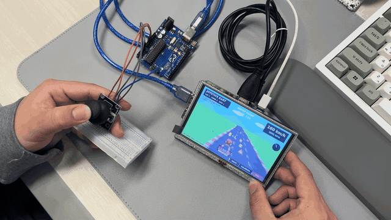
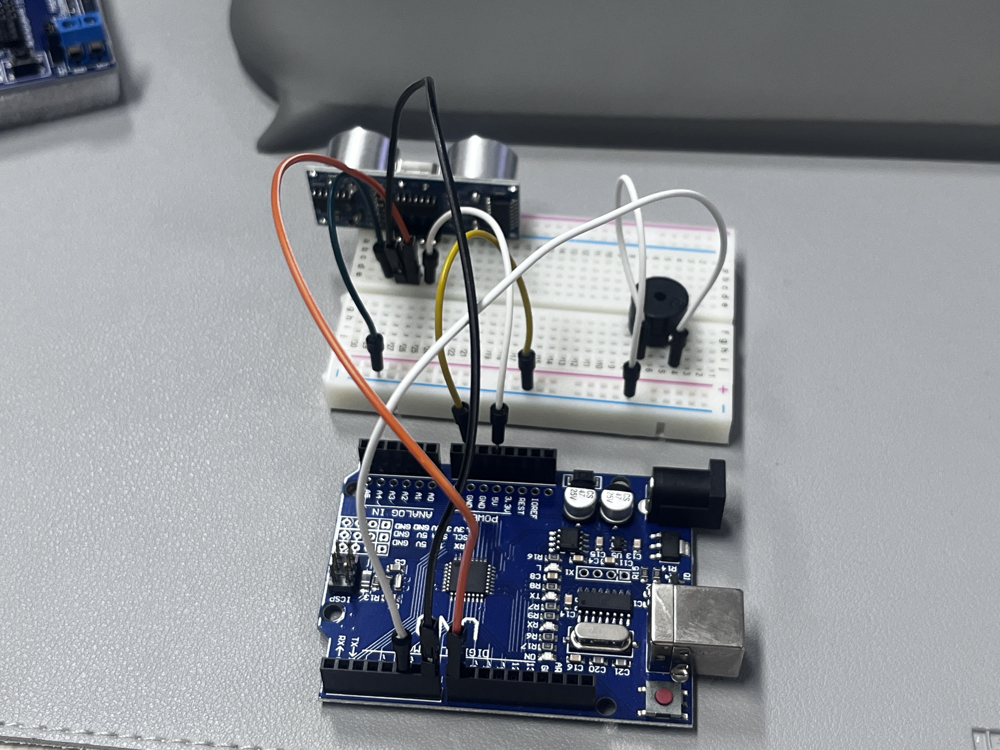
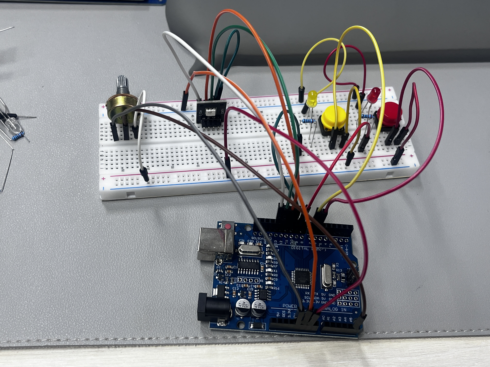

# Arduino Mini Projects

Arduino UNO와 센서·LED·조이스틱을 활용한 미니 프로젝트 모음입니다. 카트 시뮬레이터는 Raspberry Pi 5에서 화면을 출력하고, UNO가 조이스틱 입력을 USB 시리얼로 전달합니다.

## 프로젝트

| 프로젝트 | 내용 | 코드 |
| --- | --- | --- |
| Joystick Kart | 조이스틱 카트 레이싱, 20초 제한, 코인·장애물·부스터 | [Python 게임](Joystick_Kart/kart_simulator.py) · [UNO 입력 코드](Joystick_Kart/JoystickDashboard/JoystickDashboard.ino) |
| Parking Sensor | 초음파 거리 측정 및 거리별 부저 경고 | [Arduino 코드](Parking_Sensor/Parking_Sensor.ino) |
| Switch + Potentiometer + LED | 버튼 2개로 LED 제어, 가변저항으로 RGB 색상 조절 | [Arduino 코드](Switch_Poten_LED/Switch_Poten_LED.ino) |

## 1. Joystick Kart

### 플레이 미리보기



시연 영상의 중간 **12~20초 구간**을 추출한 반복 재생 GIF입니다. README에서 바로 볼 수 있도록 폭 640px, 초당 10프레임으로 변환했습니다. 원본 MOV와 압축 MP4는 로컬에 보존하고 저장소에는 GIF를 포함합니다.

### 구성과 배선

- Raspberry Pi 5 + HDMI 디스플레이 + USB 터치
- Arduino UNO + HW-504 조이스틱
- UNO와 Pi 연결용 USB 데이터 케이블

| HW-504 | UNO |
| --- | --- |
| +5V | 5V |
| GND | GND |
| VRx | A0 |
| VRy | A1 |
| SW | D2 (`INPUT_PULLUP`) |

LCD의 HDMI는 Pi의 micro-HDMI 출력에, USB TOUCH는 Pi의 USB에 연결합니다. LCD 전원은 제품 사양에 맞춰 공급합니다. 조이스틱은 UNO에 연결하며, Pi GPIO와 직접 연결하지 않습니다.

### 설치 및 실행

1. Arduino IDE에서 `Joystick_Kart/JoystickDashboard/JoystickDashboard.ino`를 UNO에 업로드합니다.
2. UNO를 Pi USB에 연결합니다. 시리얼 속도는 **115200 baud**, 전송 형식은 `X,Y,버튼`입니다.
3. Raspberry Pi OS **데스크톱** 환경에서 저장소를 복제하고 실행합니다.

```bash
sudo apt update
sudo apt install -y git python3-serial python3-tk
sudo usermod -aG dialout "$USER"
```

`dialout` 권한 변경 후 로그아웃·로그인하거나 재부팅합니다.

```bash
git clone https://github.com/haengmini/Arduino_Mini_proj.git
cd Arduino_Mini_proj/Joystick_Kart
python3 kart_simulator.py
```

일반 SSH 세션에는 화면 환경이 없어 Tkinter 오류가 발생할 수 있습니다. 첫 실행은 Pi 바탕화면 터미널에서 진행합니다.

### 조작과 규칙

| 조작 | 기능 |
| --- | --- |
| 위 / 아래 | 가속 / 브레이크 |
| 좌 / 우 | 조향 |
| 조이스틱 버튼 | 부스터 (1.8초, 재사용 간격 6초) |
| RESET / CALIBRATE | 재시작 / 중앙 보정 |
| EXIT 또는 Esc | 종료 |
| 키보드 방향키 / Space | 시험 주행 / 부스터 |

현재 기본 방향은 사용한 조이스틱 설치 방향에 맞춰 **VRx 증가 = 가속, VRy 증가 = 우회전**입니다. 장착 방향이 다르면 옵션으로 변경합니다.

```bash
python3 kart_simulator.py --invert-y
python3 kart_simulator.py --swap-axes
python3 kart_simulator.py --port /dev/ttyACM0
```

옵션은 필요에 따라 조합할 수 있습니다. 조이스틱을 놓고 `CALIBRATE`를 눌러 중앙을 보정합니다. 화면의 `X`, `Y`, `GAS`로 입력을 확인할 수 있습니다.

- 처음 가속한 시점부터 **20초** 동안 주행합니다.
- 최고속도: 시작 **160**, 5초 **220**, 10초 **300**, 15초 **360 km/h**. 부스터 한도는 각 단계에서 +50 km/h입니다.
- 코인 획득 시 머리 위에 금색 동전과 `+1` 표시가 뜹니다.
- 라바콘 충돌 시 감속하며, 붉은색 화면 효과가 두 번 깜빡입니다.
- 결과 점수: **SCORE = COINS × 100 − HITS × 300 + 반올림한 DISTANCE**. 음수 점수도 가능합니다.
- 속도·RPM·거리 표시는 게임 시뮬레이션 값입니다.

### 바탕화면 실행 아이콘

현재 설치 스크립트는 게임 위치를 `~/Desktop/kart`로 사용합니다.

```bash
mkdir -p ~/Desktop/kart
cp kart_simulator.py install_kart_launcher.sh ~/Desktop/kart/
bash ~/Desktop/kart/install_kart_launcher.sh
```

바탕화면의 **Joystick Kart** 아이콘으로 실행합니다. 실행 허용 안내가 나오면 허용합니다.

## 2. Parking Sensor



HC-SR04 초음파 센서와 수동 부저를 이용한 모형·실습용 거리 경보기입니다.

| 부품 | UNO |
| --- | --- |
| ECHO / TRIG | D7 / D8 |
| 센서 VCC / GND | 5V / GND |
| 부저 + / − | D5 / GND |

| 거리 | 부저 |
| --- | --- |
| 30cm 초과 또는 응답 없음 | 꺼짐 |
| 20cm 초과 ~ 30cm | 600ms 간격 |
| 10cm 초과 ~ 20cm | 300ms 간격 |
| 5cm 초과 ~ 10cm | 150ms 간격 |
| 5cm 이하 | 연속음 |

Arduino IDE에서 스케치를 업로드하고, **9600 baud** 시리얼 모니터로 측정값을 확인합니다.

## 3. Switch + Potentiometer + LED



스위치를 누르는 동안 단색 LED가 켜지고, 가변저항으로 RGB 색상을 바꿉니다. 입력 필터와 색상 보간을 적용했습니다.

| 부품 | 현재 코드의 UNO 핀 |
| --- | --- |
| 가변저항 가운데 핀 | A5 |
| SW1 / SW2 | D6 / D7 (각 스위치의 반대쪽은 GND) |
| LED1 / LED2 | D9 / D10 |
| RGB R / G / B | D11 / D12 / D13 |

**UNO PWM 관련 확인:** 현재 원본 코드의 D12·D13은 PWM 핀이 아니므로 RGB의 G·B 밝기가 부드럽게 조절되지 않습니다. 부드러운 색 변화가 필요하면 `greenPin = 5`, `bluePin = 3`으로 변경하고 해당 배선도 D5·D3으로 옮기세요. R은 D11을 유지할 수 있습니다. 저장소의 원본 배선·코드는 변경하지 않았습니다.

가변저항 양 끝은 5V와 GND에 연결합니다. 단색 LED와 저항 미내장 RGB에는 채널별 직렬 저항을 사용합니다. 공통 음극 RGB는 `commonAnode = false`, 공통 양극 RGB는 공통 핀을 5V에 연결하고 `true`로 설정합니다.

## 폴더 구조

```text
Joystick_Kart/
  JoystickDashboard/JoystickDashboard.ino
  kart_simulator.py
  install_kart_launcher.sh
  Joystick_Kart_demo.gif
Parking_Sensor/
  Parking_Sensor.ino
  아두이노_Parking_Sensor.jpg
Switch_Poten_LED/
  Switch_Poten_LED.ino
  아두이노_LED_Poten_switch.jpg
```

일부 폴더에는 기존 CH341 호환보드 드라이버 자료도 포함되어 있습니다. 보드가 정상 인식된다면 별도 설치는 필요하지 않습니다.

## 확인 범위

게임의 Python 문법 및 입력·점수·충돌 계산을 개발 중 점검했습니다. Raspberry Pi의 실제 화면·터치·조이스틱과 Arduino 회로의 동작은 사용하는 하드웨어에서 확인해야 합니다.
